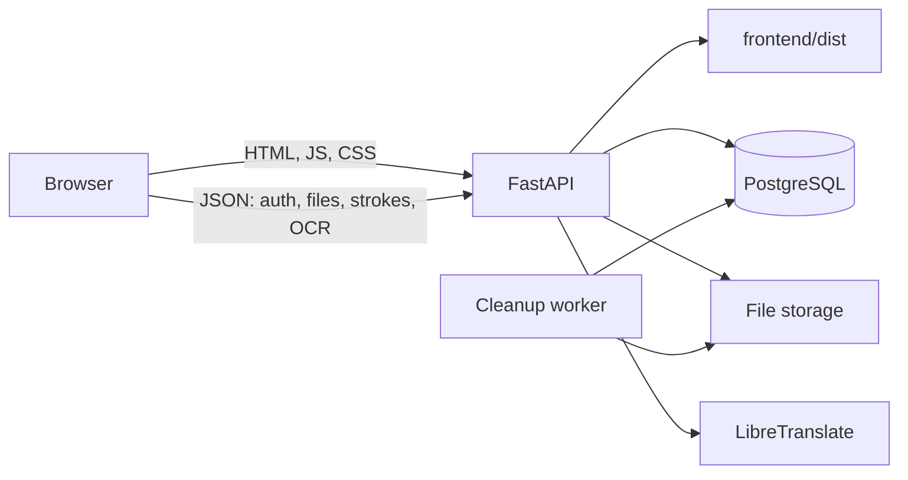

# Langbook

Langbook is a reader for language textbooks in PDF form. It keeps the book, your notes, and a translation of the line you are stuck on in the same place, so you can stay on the page instead of bouncing out to another tool.

## The problem

Reading a textbook in a language you are still learning means constant interruption. You hit an unknown word or a dense sentence, leave the PDF, paste it into a translator, copy the result back, and try to find your place again. Margin notes live in a notebook or a second app. The dictionary, the book, and the ink never sit together.

That context switch is the real cost: not the translation itself, but breaking reading flow every few lines.

## What Langbook does

You upload a textbook into a private library and open it in the browser. Draw on the page as you would in a paper copy. When a passage is unclear, switch to gloss mode, select it, and Langbook OCR’s the crop (Russian) and translates it to English beside the page. Ink is saved as you lift the pen and comes back when you reopen the file.

The product is that loop — read, mark, gloss — without leaving the reader.

## Features

- Account registration and login (Argon2 passwords, JWT access tokens).
- Per-user PDF library: upload, list, download, delete, with SHA-256 checksums and ownership checks.
- PDF reader with stylus/mouse ink. Strokes are stored in PDF scale-1 coordinates and drawn at the current display scale.
- Strokes auto-save on pointer up (`POST /files/{id}/strokes`) and reload per page.
- Gloss mode: drag a selection, run Tesseract OCR, translate with LibreTranslate.
- Storage quotas with reserved capacity for in-progress uploads.
- Chunked resumable uploads and a background worker that expires abandoned sessions.
- Docker Compose stack: API, Postgres, translator, cleanup worker.

## Architecture

The HTTP API, file storage, and metadata live in FastAPI and PostgreSQL. The browser UI is a Vite TypeScript app that FastAPI serves as static files. Node is used only to build that frontend, not as the production server.



**Pages** (multi-page app, not a client-side router):

| URL | Role | UI |
|---|---|---|
| `/` | Library | React |
| `/viewer?file={id}` | PDF + ink + gloss | TypeScript and canvas |
| `/login`, `/signup` | Auth forms | TypeScript |

The library page is React because it is list and async UI (cards, upload, thumbnails). The viewer stays imperative: pointer events write to a canvas; putting every point in React state would redraw on every `pointermove`.

**Strokes.** Points are saved in PDF user space (scale 1). The viewer multiplies by the current render scale (1.5 today) when drawing. That keeps ink aligned if zoom or device pixel ratio changes. Each stroke has a client-generated UUID; inserts use `ON CONFLICT DO NOTHING`.

**Dev vs production.** `npm run dev` runs Vite on port 5173 and proxies `/files`, `/auth`, `/api`, `/uploads`, and `/health` to FastAPI on 8000 so the browser stays same-origin. Production and Docker build `frontend/dist`; FastAPI serves those files and the API from one host.

## Stack

| Layer | Tools |
|---|---|
| API | Python 3.14, FastAPI, SQLAlchemy, Alembic |
| Database | PostgreSQL 16 |
| Auth | Argon2, JWT |
| OCR / translation | Tesseract (`rus`), LibreTranslate (`ru` → `en`) |
| Frontend | TypeScript, Vite, React (library only), PDF.js, canvas |
| Quality | Pytest, Ruff, GitHub Actions |

## Getting started

### Prerequisites

- Git, Docker, and Docker Compose
- Python 3.14 and Node 22 if you run tools on the host

### 1. Clone

```bash
git clone https://github.com/kha-adam/word-texbook-translator.git
cd word-texbook-translator
```

### 2. Environment files

The app reads `.env` (host) and Compose uses `.env.docker` for the API container. Neither file is committed. Create both with at least:

| Variable | Purpose |
|---|---|
| `DATABASE_URL` | SQLAlchemy URL (`postgresql+psycopg://…`) |
| `STORAGE_DIR` | Directory for uploaded files |
| `FRONTEND_DIR` | Built UI directory (`frontend/dist` on the host, `/code/frontend/dist` in the API image) |
| `JWT_SECRET_KEY` | Random secret used to sign tokens |
| `JWT_ALGORITHM` | Defaults to `HS256` |
| `JWT_ACCESS_TOKEN_EXPIRE_MINUTES` | Token lifetime |
| `MAX_UPLOAD_SIZE` | Max upload size in bytes (default 100 MiB) |
| `MAX_STORAGE_PER_USER` | Quota in bytes (default 500 MiB) |
| `TRANSLATE_URL` | LibreTranslate base URL |
| `POSTGRES_USER`, `POSTGRES_PASSWORD`, `POSTGRES_DB` | Database container credentials |

Use a dedicated test database for Pytest. Never point tests at data you care about.

### 3. Run with Docker

```bash
docker compose up --build -d
docker compose exec api alembic upgrade head
```

Then open `http://localhost:8000`. OpenAPI docs: `http://localhost:8000/docs`.

The image builds the frontend in a Node stage, then copies `frontend/dist` into the Python image. Tesseract with the Russian pack is installed in that image.

Logs:

```bash
docker compose logs -f api
docker compose logs -f cleanup-worker
```

### 4. Frontend on the host (optional)

With the API already on port 8000:

```bash
cd frontend
npm install
npm run dev
```

Vite serves the UI (typically `http://127.0.0.1:5173`) and proxies API routes to FastAPI.

Production-style static files:

```bash
cd frontend
npm run build
```

Then set `FRONTEND_DIR=frontend/dist` and run Uvicorn. `npm run build` type-checks with `tsc --noEmit` before bundling.

## How storage quotas work

Used bytes and **reserved** bytes both count toward the cap:

`storage_used + reserved_storage <= max_storage_per_user`

A reservation is taken with a conditional SQL update so two concurrent uploads cannot both squeeze through on the same remaining budget. Completing an upload converts the reservation into used storage; cancel or expiry releases it. The cleanup worker (`CLEANUP_INTERVAL_SECONDS`, default 300) deletes expired resumable sessions and their temp files.

## API overview

| Area | Endpoints |
|---|---|
| Auth | `POST /auth/register`, `POST /auth/login`, `GET /auth/me` |
| Files | `POST /files`, `GET /files`, `GET /files/{id}/download`, `DELETE /files/{id}` |
| Strokes | `POST /files/{id}/strokes`, `GET /files/{id}/pages/{page}/strokes` |
| OCR | `POST /api/ocr` |
| Resumable uploads | `POST /uploads`, `PUT /uploads/{id}/chunks/{index}`, `GET /uploads/{id}`, `POST /uploads/{id}/complete` |

File and stroke routes require `Authorization: Bearer <token>` and check ownership.

## Testing and CI

Apply migrations to the test database, then:

```bash
pytest -v
ruff check .
ruff format --check .
```

GitHub Actions (`.github/workflows/ci.yml`) builds the frontend, runs Pytest against PostgreSQL 16, then Ruff. Frontend type-checking is part of `npm run build`.

## Project structure

```text
word-texbook-translator/
├── app/                    # FastAPI application
│   ├── main.py             # Routes for HTML pages + static mount
│   ├── routes.py           # JSON API
│   ├── models.py
│   ├── services/           # files, users, strokes
│   └── workers/cleanup.py
├── frontend/               # Vite source (output: frontend/dist)
│   ├── src/library/        # React library page
│   ├── src/viewer/         # Canvas reader
│   ├── src/auth.ts
│   └── src/api.ts
├── alembic/versions/
├── tests/
├── scripts/                # Upload/download benchmarks
├── docker-compose.yml
└── Dockerfile
```

## Limitations

- Tokens live in `localStorage` (simple, but vulnerable to XSS compared with HttpOnly cookies).
- OCR language is Russian; translation is Russian to English.
- Files sit on a local disk volume, not object storage.
- Ink has no undo/erase UI yet.
- There is no hosted public demo.

This is also a learning and portfolio project: the reading loop sits on a storage API that takes quotas, interrupted uploads, and ownership seriously.
